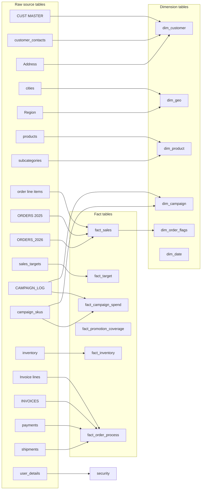

# Power BI Portfolio Project: Stage 1 - Data Transformation

This stage takes **22 raw source tables** and uses **Power Query** to shape them into a **galaxy schema** (also called a fact constellation): several fact tables that share a common set of dimension tables.

The result is **6 dimension tables**, **6 fact tables** and **1 security table**, ready to be connected into a data model in Power BI.

A slide deck that walks through the same story is included: [`Stage1_Data_Transformation.pptx`](Stage1_Data_Transformation.pptx).

---

## At a glance

| | |
|---|---|
| Tools | Power Query (Power BI), plus DAX for `dim_date` |
| Raw source tables | 22 |
| Dimension tables | 6 |
| Fact tables | 6 |
| Other model tables | 1 (security) |
| Raw tables removed from the model | 5 |
| Target design | Galaxy schema |

---

## Approach

Each table was built one at a time in Power Query, in a deliberate order: starting with the customer dimension and payments, and finishing with the date dimension as the very last step before connecting the data model.

Following that order keeps the work easy to follow: every model table has a clear set of raw source tables and a clear role.

### Rules applied across the model

1. **snake_case headers:** every column header, in every table, was standardised to snake_case (for example, `Customer Name` becomes `customer_name`).
2. **No duplicate rows in dimensions:** duplicates were removed from the dimension tables so each dimension row is unique.
3. **Lowest grain for sales:** `fact_sales` is built on order line items, the lowest data grain. Columns holding totals or measures were removed.

---

## Transformation flow

`fact_promotion_coverage` is a factless fact table made of key columns that point to other tables. `dim_date` is created as the last step.

---

## Source-to-target mapping

Steps are listed in the order they were built.

| Step | Model table | Type | Raw source table(s) |
|---|---|---|---|
| 1 | `dim_customer` | Dimension | CUST MASTER, customer_contacts, Address |
| 2 | `dim_geo` | Dimension | cities, Region |
| 3 | `dim_product` | Dimension | products, subcategories |
| 4 | `fact_sales` | Fact | order line items, ORDERS 2025, ORDERS_2026 |
| 5 | `dim_order_flags` | Junk dimension | Columns decluttered from `fact_sales` |
| 6 | `fact_target` | Fact | sales_targets |
| 7 | `fact_campaign_spend` and `dim_campaign` | Fact and dimension | CAMPAIGN_LOG, campaign_skus |
| 8 | `fact_promotion_coverage` | Factless fact | Two key columns referencing other tables |
| 9 | `fact_inventory` | Fact | inventory |
| 10 | `fact_order_process` | Accumulating snapshot fact | Invoice lines, INVOICES, payments, shipments |
| 11 | `security` | Security | user_details |
| 12 | `dim_date` | Dimension | Generated with the DAX function `CALENDARAUTO()` |

---

## How the main tables were built

**`fact_sales`**
- The ORDERS 2025 and ORDERS_2026 tables were appended into one table.
- Order line items is the skeleton of the fact table, because it holds the lowest data grain.
- Columns holding totals or measures were removed.

**`dim_customer`**
- CUST MASTER, customer_contacts and Address were merged into one customer dimension, with duplicates removed.

**`dim_date`**
- Generated with the DAX function `CALENDARAUTO()`, then year, quarter, month and day were extracted.
- Created last, as the final step before connecting the data model.

---

## Table types used

- **Dimension tables** describe the "who, what, where and when" that facts are analysed by: customers, geography, products, campaigns and dates.
- **Junk dimension (`dim_order_flags`)** gathers flag-style columns out of `fact_sales` into one small dimension so the fact table stays uncluttered.
- **Factless fact (`fact_promotion_coverage`)** contains just two columns, full of keys that refer to other tables.
- **Accumulating snapshot fact (`fact_order_process`)** follows the order process using invoice lines, INVOICES, payments and shipments.
- **Security table (`security`)** is built from `user_details`.

---

## Raw tables removed from the model

These were part of the raw sources but are not in the final model:

`exchange_rates` | `Channels` | `orders` | `fact` | `Sheet1`

They were removed because they added no extra information, some arrived broken from the source, and some did not fit the schema.

---

## Why a galaxy schema?

A galaxy schema has more than one fact table, and those fact tables share dimensions. Here, sales, targets, campaign spend, promotion coverage, inventory and order process each get their own fact table, so each business process is modelled at its own level of detail while still being analysed by the same dimensions.

---

## What's next

With every table built and `dim_date` created, the next stage is connecting these tables into the data model in Power BI.

---

## Repository contents

| File | Description |
|---|---|
| `README.md` | This document |
| `Stage1_Data_Transformation.pptx` | Slide deck walking through the transformation |
